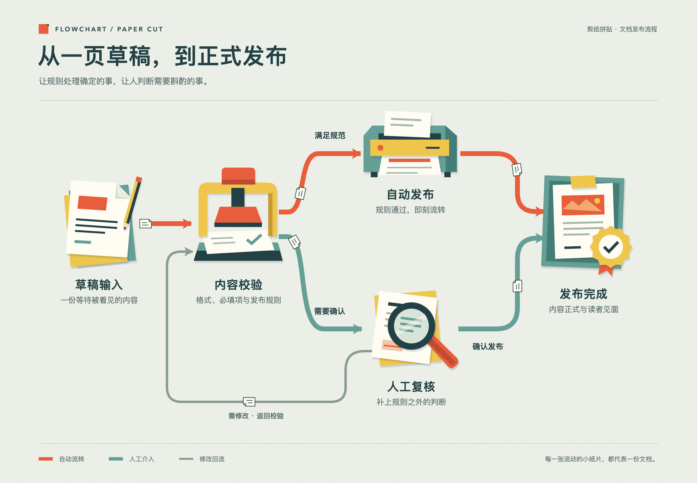

# Flowchart · 剪纸拼贴动画流程图

一个专注 **Paper-cut Collage** 的绘图技能：用具象纸艺物件、清晰切边、薄纸叠层和有含义的动作，解释流程与系统关系。

[GitHub 仓库](https://github.com/Ankh2454/flowchart) · [在线预览](https://ankh2454.github.io/flowchart/) · [下载源码](https://github.com/Ankh2454/flowchart/archive/refs/heads/main.zip) · [反馈问题](https://github.com/Ankh2454/flowchart/issues)



## 能做什么

- 流程图、系统架构、数据流、任务管线、生命周期及技术科普图。
- 内置 **24 项素材：8 个可编辑 SVG + 16 个透明 PNG**，覆盖基础设施、AI、安全、流程控制与协作。
- 根据主题设计物件，保留分支、汇聚、重试和回流。
- 交付可离线打开的单文件 HTML、PNG 及无缝循环 GIF。
- 在同一剪纸风格内调整品牌色、字号、内容密度；参考图用于校准材质和构图。

技能只专注剪纸拼贴。可以直接使用随库附带的 SVG/PNG，无需生图 API。PNG 是经模型生成与色板归一的整体插画；需要内部部件动画时使用可编辑 SVG。

## 安装

使用 Skills CLI 安装（需要 Node.js）：

```bash
npx skills add Ankh2454/flowchart --skill flowchart
```

按提示选择使用的代理与安装位置。只查看可安装技能：

```bash
npx skills add Ankh2454/flowchart --list
```

也可直接安装到 Codex 的技能目录（目标目录须不存在）：

```bash
git clone https://github.com/Ankh2454/flowchart.git ~/.codex/skills/flowchart
```

已有本地版本时先保留自己的修改，再更新；不要直接覆盖正在编辑的技能目录。
安装完成后，在新会话中调用 `$flowchart`。

## 使用


```text
使用 $flowchart，把下面的订单退款流程画成剪纸拼贴动画图。
保留审批分支和退款失败后的重试，导出 HTML、PNG、GIF。
```

```text
使用 $flowchart，画出 API → 消息队列 → Worker → 数据库的异步任务架构。
失败后返回队列，成功后通知用户。节点和关系以我的描述为准。
```

```text
使用 $flowchart，保留剪纸质感，将强调色改为我的品牌蓝。
这张图用于手机阅读，请采用纵向构图。
```

也可将目录安装到其他支持 `SKILL.md` 的代理工具的技能路径。技能本身不要求 Codex 专属 API。

## 配色与图标精修

新图优先采用暖纸底、低饱和青绿和陶土橘，附带 8 个可编辑的精修 SVG 版本。
经典 24 项素材继续保留；精修版覆盖同样的 8 类基础概念，不增加概念数量。

- [三组配色与图标对照](examples/color-icon-comparison.html)：原版、仅换色、换色并改造型。
- [精修异步任务](examples/async-jobs-refined.html)：在完整流程中检查图标、路径与动态。
- [配色与图标规范](references/color-icons.md)：颜色分工、轮廓、光学尺寸和素材混用。

## 示例

- [文档发布动画](https://ankh2454.github.io/flowchart/examples/publishing.html)：物件造型、两条发布分支、修改回流。
- [异步任务动画](https://ankh2454.github.io/flowchart/examples/async-jobs.html)：技术主题、队列、Worker、存储与失败重试。
- [完整素材库](https://ankh2454.github.io/flowchart/examples/material-library.html)：24 项素材，可按关键词或类别筛选并下载。
- [智能问答流程](https://ankh2454.github.io/flowchart/examples/knowledge-workflow.html)：将新增素材与 SVG 流程动画组合。
- [纸艺物件表](https://ankh2454.github.io/flowchart/examples/objects.html)：八种可改造的基础物件。
- [风格规范](references/style-guide.md)：材质、颜色、排版和精修判断。

源码中的 `examples/` 包含对应 HTML、PNG 和 GIF。双击 HTML 可以离线查看。HTML 使用系统字体，平台间字形可能不同；PNG/GIF 固定渲染后的字形。

## 导出 GIF 与 PNG

需要 Node.js 22+、Chrome/Chromium、ffmpeg：

```bash
cd scripts
npm ci
node render-gif.mjs ../examples/publishing.html ../out/publishing.gif --poster ../out/publishing.png
```

脚本自动读取 HTML 的 `--loop`，默认 6 秒、25fps、2× 清晰度，只捕获 `.canvas`。
输出目录自动创建。可用 `--loop 6000 --fps 25 --scale 2` 覆盖。
`CHROME_PATH` 和 `FFMPEG_PATH` 可指定可执行文件，否则尝试常见浏览器位置与 PATH 中的 ffmpeg。

动画必须是可定格的 CSS 动画，周期整除全局 loop。脚本会拒绝非循环、正延迟或周期不匹配的动画，
避免悄悄导出有接缝的文件。它检查录制条件，不替代视觉检查。

## 扩展生成素材

16 项新增插画使用本地 `flux2-klein-4b` 模型生成，再统一色板、透明背景和 512px 画布。
完整提示词与 seed 保存在 [素材目录](assets/raster/catalog.json)，用法见 [生成素材规范](references/raster-assets.md)。
库内素材可以直接离线使用；只有重新生成时才需要兼容的图像服务。

```bash
python3 scripts/generate-assets.py --api-base http://127.0.0.1:8120 --out out/raw --only ai-chip
python3 -m pip install -r scripts/requirements-assets.txt
python3 scripts/normalize-assets.py --raw out/raw --out out/normalized --only ai-chip
```

## 运行测试

使用已安装 Chrome/Chromium 与 ffmpeg 的环境，在仓库根目录执行：

```bash
npm ci --prefix scripts
python3 -m pip install -r scripts/requirements-assets.txt
python3 -m unittest discover -s scripts/tests -v
node scripts/tests/browser.mjs
```

非标准安装位置可设置 `CHROME_PATH`、`FFMPEG_PATH`；测试需要 Node.js 22+ 和 Python 3.10+。
测试使用本机模拟图像服务，不调用真实生图模型。覆盖任务恢复、损坏 PNG、色板与透明边距、
真实 GIF 编码、离线示例、循环首尾、减少动态效果、移动端布局及全部 24 项素材下载。
测试输出写入系统临时目录并自动清理，不覆盖示例。GitHub Actions 在 PR 和发布前自动运行；
通过测试后才部署 Pages。自动测试不能替代对新素材或新流程图的实际美术与语义检查。

## 源码结构

- `SKILL.md`：技能入口。
- `references/`：美术、布局动效和 SVG 做法。
- `assets/`：可内联的 CSS 与八种 SVG 纸艺物件。
- `scripts/`：GIF/PNG 导出工具及锁定依赖。
- `examples/`：自包含示例与预览。

仓库地址：<https://github.com/Ankh2454/flowchart>。

`SKILL.md` 位于仓库根目录；所有引用使用相对路径。`.gitignore` 排除依赖、临时输出与系统文件。
在线示例由 GitHub Pages 自动发布，更新 `main` 后会同步部署。
